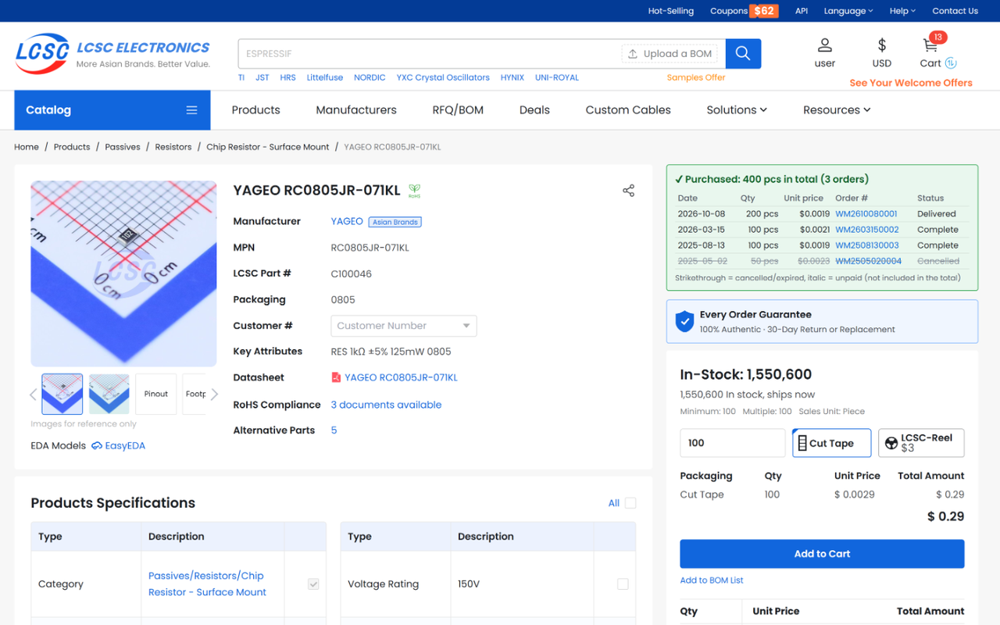

# Purchase History for LCSC (Unofficial)

[English](#english) | [日本語](#日本語)

A Chrome extension that shows, on LCSC product pages, whether you have already bought the part — with the order dates, quantities, unit prices and order numbers from your own LCSC order history.

> This is an unofficial extension. It is not affiliated with, endorsed by, or sponsored by LCSC Electronics.

The order data in the screenshot is sample data. / スクリーンショットの注文データはサンプルです。

---

## English

### Features

- Shows a small box above the price section of every LCSC product page (`https://www.lcsc.com/product-detail/...`)
- Total quantity and number of orders for that part
- Date, quantity, unit price, order number (linked to the order page) and status of each order
- Cancelled / expired / unpaid orders are listed but not counted in the total
- English and Japanese UI (follows your browser language)

### Install

1. Download `purchase-history-for-lcsc-<version>.zip` from the [Releases](../../releases) page and extract it to a folder you will keep (the extension stops working if the folder is moved or deleted)
2. Open `chrome://extensions` in Chrome
3. Turn on **Developer mode** (top right)
4. Click **Load unpacked** and select the extracted folder
5. Sign in to LCSC and open any product page

### Update

The extension does not update automatically. Download the new zip, replace the contents of the folder, then click the reload button (↻) for this extension on `chrome://extensions`.

### Privacy

- Uses your existing signed-in LCSC session; you never enter a password into the extension
- Talks only to LCSC's own servers; no analytics, no tracking, nothing sent to the developer or third parties
- Order line items are cached locally in your browser (`chrome.storage.local`)

See [PRIVACY.md](PRIVACY.md) for details.

### Notes

- Quantities are as ordered; partial refunds for out-of-stock items are not reflected
- It relies on LCSC's website and internal API, so it may stop working if LCSC changes them. Please report problems in [Issues](../../issues).

---

## 日本語

LCSC の商品ページに、その部品を過去に買ったことがあるか（購入日・数量・単価・注文番号）を表示する Chrome 拡張です。

> LCSC Electronics とは関係のない非公式の拡張です。

### 機能

- LCSC の商品ページ（`https://www.lcsc.com/product-detail/...`）の価格欄の上に表示
- その部品の合計購入数と注文回数
- 注文ごとの購入日・数量・単価・注文番号（注文ページへのリンク）・状態
- キャンセル・期限切れ・未払いの注文は表示するが、合計には含めない
- 日本語・英語に対応（ブラウザの言語に合わせて切り替わる）

### インストール

1. [Releases](../../releases) から `purchase-history-for-lcsc-<バージョン>.zip` をダウンロードし、残しておくフォルダに展開する（フォルダを移動・削除すると動かなくなります）
2. Chrome で `chrome://extensions` を開く
3. 右上の「デベロッパー モード」をオンにする
4. 「パッケージ化されていない拡張機能を読み込む」で展開したフォルダを選ぶ
5. LCSC にログインして商品ページを開く

### 更新

自動では更新されません。新しい zip をダウンロードしてフォルダの中身を入れ替え、`chrome://extensions` でこの拡張の再読み込みボタン（↻）を押してください。

### プライバシー

- ログイン中の LCSC のセッションを使います。拡張機能にパスワードを入力することはありません
- 通信先は LCSC のサーバーだけです。アクセス解析・トラッキングはなく、開発者や第三者にデータを送ることもありません
- 注文の明細をブラウザ内（`chrome.storage.local`）に保存します

詳しくは [PRIVACY.md](PRIVACY.md) を見てください。

### ご注意

- 数量は注文時の数です。欠品による一部返金などは反映されません
- LCSC のサイトと内部 API を使っているため、LCSC 側の変更で動かなくなることがあります。不具合は [Issues](../../issues) へ

---

## For developers / 開発者向け

- `python build_zip.py` — creates the release zip in `dist/` / 配布用 zip を `dist/` に作る
- UI strings / 表示文言: `_locales/<lang>/messages.json`
- How it works / しくみ: searches your orders with `wmsc.lcsc.com/wmsc/order/page` by part number, then reads quantities from `wmsc.lcsc.com/wmsc/order/detail`
- [STORE_LISTING.md](STORE_LISTING.md) — notes for publishing on the Chrome Web Store / Chrome ウェブストアに出す場合のメモ

## License

[MIT](LICENSE)
